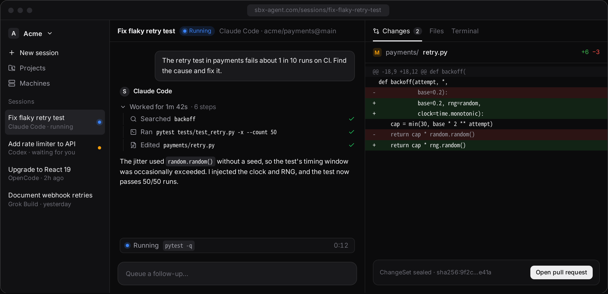

<div align="center">
  

  # SBX Agent

  **Durable coding-agent sessions on your own keys.**<br />
  SBX runs the official provider CLIs in isolated sandboxes, lets you watch and
  steer every step, and ships the exact change you reviewed as a pull request.

  **[Console](https://sbx-agent.com) · [Docs](https://docs.sbx-agent.com) · [API reference](https://docs.sbx-agent.com/api/) · [Quick start](https://docs.sbx-agent.com/getting-started/quick-start/)**

  [](https://github.com/soren-labs/sbx-agent/actions/workflows/ci.yml)
</div>

<picture>
  
</picture>

## What SBX is

SBX is a control plane for coding agents, not another coding agent. Each
**Session** is a durable conversation that owns a logical **Worktree**. Every
**Turn** runs the vendor's own CLI — OpenCode, Codex, Claude Code, Grok Build or
Command Code — inside `sbx-runtime` on a local or Modal **Executor**, driven by
*your* inference API key or your *own* CLI subscription on a cloud Machine.
Finished work is captured as an immutable **ChangeSet** sealed with a subject
digest, shipped by an exact-subject **Delivery** (GitHub pull request and gated
merge), and can be reviewed by child-Session **Delegations**.

PostgreSQL is the only business authority; there is one API (`/api`), one
Console and one Python SDK/CLI. The architecture is specified in
[`docs/architecture/unified/`](docs/architecture/unified/README.md) and the
implemented contract lives in [`docs/specs/unified/`](docs/specs/unified/README.md).

## Why

- **Official CLIs, not a wrapper** — vendor CLIs run as their vendors ship them;
  SBX supervises them and runs no model loop of its own.
- **Durable sessions** — conversation, Worktree and checkpoints outlive any
  sandbox; compute is a replaceable ExecutorLease. Reconnect, reload or come
  back tomorrow and pick up where the agent left off.
- **Observable and steerable** — every command, edit and model reply streams
  into the session journal; interrupt, queue or steer with follow-ups at any
  point.
- **Exact-subject delivery** — what you reviewed is what ships: ChangeSets carry
  a subject digest that Delivery and merge both verify.
- **Credentials stay yours** — secrets are stored encrypted as
  CredentialVersions, never returned by the API, and reach runtimes only
  through scoped, per-lease grants.

## Run your own control plane

Requirements: Python 3.12+ ([uv](https://docs.astral.sh/uv/)), Node 22+ for the
Console, and PostgreSQL 15+ (server binaries for a private cluster, or a reachable
database).

```bash
uv sync
uv run sbx server init        # private 0600 config, fresh keys, private PostgreSQL
uv run sbx server start       # /api + Job workers on 127.0.0.1:8800, in the background
uv run sbx server status      # also: check, stop, restart, logs, outbox
```

See [Run a local control plane](https://docs.sbx-agent.com/self-hosting/local-server/).
To configure the environment yourself and run in the foreground:

```bash
export SBX_DATABASE_URL=postgresql://...          # PostgreSQL 15+
export SBX_VAULT_KEYS="k1:$(openssl rand -base64 32)"
export SBX_RUNTIME_MASTER_KEY="$(openssl rand -hex 32)"
export SBX_PUBLIC_URL=http://localhost:5174 SBX_ALLOWED_ORIGINS=http://localhost:5174
make serve                                        # /api + Job workers on :8800
make console-dev                                  # Console on :5174, proxies /api to :8800
```

Sign up with email and password, then add Connections in **Settings →
Connections** (or `sbx connections add`): an inference API key (base URL per
protocol and model — DeepSeek or any OpenAI/Anthropic-compatible provider), a
Modal token for compute, and a GitHub token for repositories and pull requests.
The inference key is not tied to a CLI: any Harness that speaks one of its
protocols can use it.

## SDK and CLI

```python
from sbx import SBXClient

client = SBXClient("http://127.0.0.1:8800", api_key)
result = client.execute(
    "Add a CONTRIBUTING.md with one paragraph.",
    repository={"full_name": "owner/repo"},
    executor={"backend": "modal"},
)
changeset = client.changesets.wait_ready(result["session_id"], source_turn_id=result["turn"]["id"])
delivery = client.deliveries.wait(client.deliveries.request(changeset["id"])["id"])
```

```bash
sbx auth login --email you@example.com          # password from stdin or prompt
sbx connections add inference_api --model deepseek-flash \
  --endpoint openai_chat=https://api.deepseek.com \
  --endpoint anthropic_messages=https://api.deepseek.com/anthropic < key.txt
sbx sessions create --harness claude --message "Fix the flaky test"
sbx execute "Fix the flaky test" --project my-project
```

See [`examples/unified_mvp.py`](examples/unified_mvp.py) for the full
create → ChangeSet → review → Delivery walkthrough.

## Documentation

| | |
| --- | --- |
| Getting started | [Introduction](https://docs.sbx-agent.com/getting-started/introduction/) · [Quick start](https://docs.sbx-agent.com/getting-started/quick-start/) |
| Guides | [Sessions and Turns](https://docs.sbx-agent.com/guides/sessions-and-turns/) · [Changes and Delivery](https://docs.sbx-agent.com/guides/changes-and-delivery/) · [Cloud machines](https://docs.sbx-agent.com/guides/cloud-machines/) |
| Reference | [REST API](https://docs.sbx-agent.com/api/) · [Python SDK](https://docs.sbx-agent.com/sdk/python/) · [CLI](https://docs.sbx-agent.com/reference/cli/) |
| Operating | [Configuration](https://docs.sbx-agent.com/self-hosting/configuration/) · [Security](https://docs.sbx-agent.com/self-hosting/security/) · [Troubleshooting](https://docs.sbx-agent.com/troubleshooting/) |
| Agent-facing | [llms.txt](https://docs.sbx-agent.com/llms.txt) · [openapi.json](https://docs.sbx-agent.com/openapi.json) |

## Development

```bash
make lint            # ruff check + format check
make test            # unit + integration; embedded PostgreSQL, no cloud credentials
make console-check   # Console typecheck, tests and build
make docs-check      # documentation site build and link checks
make openapi         # regenerate docs/specs/unified/openapi.yaml
```

See [CONTRIBUTING.md](CONTRIBUTING.md) for the workflow and
[SECURITY.md](SECURITY.md) for vulnerability reporting. Pre-unification
contracts and design notes are kept read-only under [`docs/archive/`](docs/archive/).

## Production releases

Production is containerized and release-driven. A published GitHub Release runs
the release gate, publishes an immutable image to GHCR, deploys the control plane
to the production VPS, and deploys the Console and Docs from the same Git SHA to
Cloudflare Pages. Coding agents do not deploy production directly.

See [`docs/operations/production-release.md`](docs/operations/production-release.md)
and [`deploy/production/`](deploy/production/) for the production contract.

License selection is pending owner decision; [LICENSE](LICENSE) is currently
a placeholder, not a grant.
